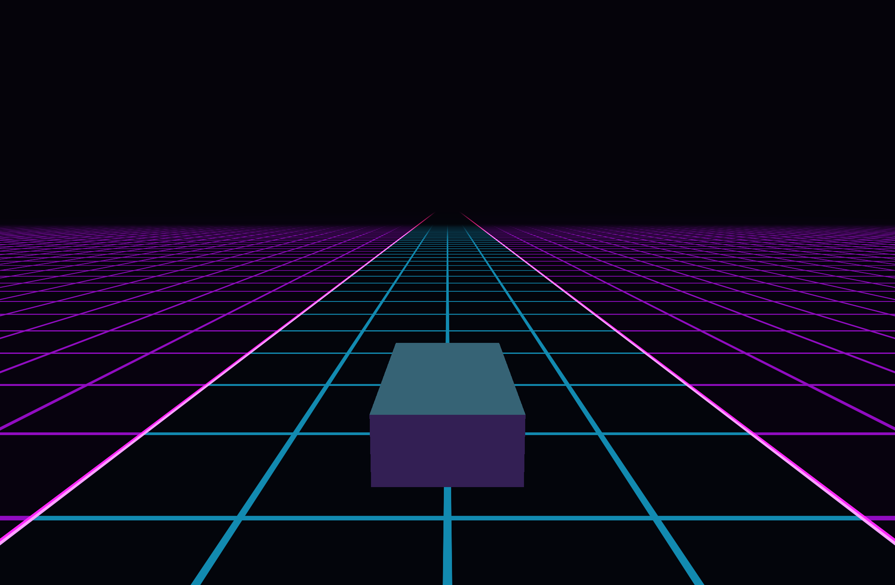

# Synthwave Drive

C++ / OpenGL final project for **Computer Graphics Fundamentals — Topic 13**.

**Status: Week 8 — Almas's framework is implemented locally.**

The working baseline contains a scrolling neon grid, speed control, two cameras, reset, shared input/math/shader utilities, and a reproducible CMake build. The stationary block is a temporary size/depth reference, not the final car. Car steering, mountains, sky/sun, lighting, and optional post-processing are still pending.



## Build and run

Verified on macOS 26.6.1 / Apple M3 Pro with Apple Clang 17, GLFW 3.5.1, GLEW 2.3.1, and CMake 4.4.5. CMake 3.19+ and C++17 are required. No GLM dependency. Windows/Linux are not yet tested; use packages that provide the CMake glfw and GLEW targets.

With Homebrew and Xcode Command Line Tools installed:

```bash
brew install cmake glfw glew
cmake -S . -B build -DCMAKE_BUILD_TYPE=Debug
cmake --build build --config Debug
./build/synthwave_drive
```

On this Mac, you can also double-click **Run.command**. It builds and launches the application. If CMake cannot find Homebrew dependencies, configure with `-DCMAKE_PREFIX_PATH="$(brew --prefix)"`.

Shaders are copied beside the executable during the build. Rebuild after changing them. Their paths are resolved relative to the executable, so launching from another working directory works. `--assets DIR` overrides the shader directory for diagnostics. The macOS application requests a 4.1 core context while using GLSL 330 / OpenGL 3.3 features.

## Current controls

- **W / S** — increase/decrease speed, bounded to 0–40.
- **C** — switch follow/presentation camera.
- **R** — reset speed, camera, and grid offset.
- **Esc** — exit.

A/D and arrow steering input is available to the future Car module; the reference block does not steer. Bloom/CRT are not implemented. Current speed and camera appear in the window title.

## Checks

```bash
ctest --test-dir build --output-on-failure
./build/synthwave_drive --smoke-test build/smoke
```

The CPU test executable runs 32 math, timing, input, state, and camera checks. The smoke test needs a graphical desktop/OpenGL context; it renders real frames and checks grid motion/repetition, camera switching, speed, reset, resizing, and GL errors. It saves PPM images. Multi-configuration builds need the relevant executable subdirectory and `ctest -C Debug`.

## Team instructions

**[AGENTS.md](AGENTS.md) contains everything in one file:** project specification, Weeks 8–10 plan, finalized framework API, shared conventions, and detailed tasks for each member.

- Almas Alkhan — framework, scrolling road, camera, integration.
- Turar Nurbauli — car, steering, hierarchy.
- Muslim Syzdykov — mountains, sky, sun.
- Nursalim Onalbayev — lighting, effects, validation.

[Almas's progress and manual publication steps](docs/progress/almas.md) · [Credits and AI use](CREDITS.md)

**Members review, commit, and push their own work. AI must not publish changes by any method.** No remote changes were made while preparing this baseline.
