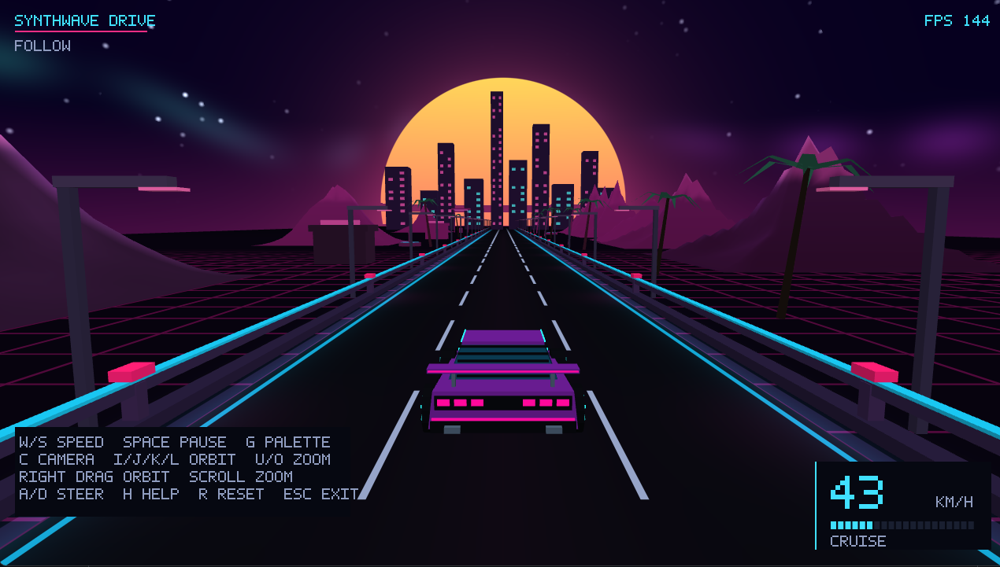

# Synthwave Drive

Computer Graphics Fundamentals final project · Topic 13 · C++17 / OpenGL.

**Current status: Almas's framework prototype, updated against the final rubric.** The scrolling road, indexed mesh utility, follow/orbit camera, keyboard/mouse input, FPS overlay and scene controls work locally. The steerable retro car and hierarchical wheels now replace the reference box; Muslim's environment is integrated. Two-light shading remains pending, with temporary preview materials on the car.



## Build and run

Requires CMake 3.19+, a C++17 compiler, OpenGL and the assignment setup's GLFW/GLEW. Tested locally on Apple M3 Pro, Apple Clang 17, OpenGL 4.1 Metal, GLFW 3.5.1 and GLEW 2.3.1. Windows/Linux and the TA computer have not yet been verified. No GLM, font or new runtime dependency is required.

```sh
cmake -S . -B build -DCMAKE_BUILD_TYPE=Release
cmake --build build --config Release
./build/synthwave_drive
```

On this Mac, double-click `Run.command`. For a fresh development Mac only, Homebrew can install `cmake glfw glew`; the TA must be able to use the established assignment setup. If needed, configure with `-DCMAKE_PREFIX_PATH="$(brew --prefix)"`. Multi-configuration generators place the executable under `build/Release`.

Shaders are copied beside the executable on every build; rebuild after edits. Paths are resolved relative to the executable, not the working directory. `--assets DIR` overrides the shader directory. macOS uses a 4.1 core context with GLSL 330-compatible shader features.

## Road and dashboard update — 9 November

The driving surface now has three lanes, six-metre dashed markings, cyan edge lines,
raised curbs, indexed 3D guardrails, and roadside lamps/reflectors repeating every
12 metres. Markings, lamps and the surrounding grid scroll toward +Z at the same
world speed. Reset restores both bounded phases. Shader derivatives filter the
road markings; the window requests 4x MSAA. Lamp spill is a procedural surface
pattern, not the team's two-light Phong system or bloom.

The follow camera uses exponentially damped lateral tracking. Integration must
call `updateFollowCamera(state, dt)` after the car writes `carX`; reset clears
`followX`. No Road or Camera method signatures changed. The dashboard shows
speed in km/h (one scene unit = one metre), speed bars, camera mode, pause and
live FPS. H hides help; small windows automatically use compact hints.

Actual captures: [follow](docs/evidence/almas-road-finished-follow.png) and
[orbit](docs/evidence/almas-road-finished-orbit.png). The road is integrated with the car and environment; common lighting remains pending.

## Controls


- W/S: increase/decrease road speed, from 0 to 40.
- C: follow/orbit camera.
- I/J/K/L or right-mouse drag: orbit; U/O or scroll: zoom. Orbit input automatically selects orbit mode.
- Space: pause/resume road motion. Camera controls remain available.
- G: switch neon palette.
- H: show/hide help; live FPS remains visible.
- R: reset speed, camera, palette, pause and road phase.
- Esc: exit.

A/D or Left/Right steers the car. Pause stops wheel rotation with the road; reset restores the car and follow camera. Bloom/CRT remain reserved. Live FPS updates every half-second. Deterministic single-frame screenshots display `FPS: --` because they do not measure real-time throughput.

## Verify locally

```sh
ctest --test-dir build --output-on-failure
./build/synthwave_drive --smoke-test build/smoke
./build/synthwave_drive --benchmark 2400
```

There are 44 CPU checks. GPU smoke checks cover road motion/repetition, camera, input, reset, resizing, mouse orbit, pause, palette and GL errors. A graphical desktop is required. Benchmarking discards 60 warm-up frames and times event polling, update, rendering, swap and GPU completion with vsync disabled. This is local prototype throughput, not a guarantee for the full scene or TA hardware.

## Team and documentation

- Almas Alkhan — framework, road, cameras, integration; SE-2425.
- Turar Nurbauli — steerable car and hierarchical transforms.
- Muslim Syzdykov — mountains, sky and striped sun.
- Nursalim Onalbayev — two-light shading, effects and validation.

[AGENTS.md](AGENTS.md) retains the complete team handbook and detailed individual instructions. [PLAN.md](PLAN.md) gives the Weeks 8–10 schedule. [Requirements](docs/requirements.md) records current gaps. [Progress](docs/progress/almas.md) records checks. [Report](docs/report/Synthwave_Drive_Progress_Report.pdf) describes the current implementation, with remaining work explicitly marked. [Demo plan](docs/demo-script.md) and [slide plan](docs/presentation-plan.md) are preparation guides, not completed final deliverables.

## AI Use

OpenAI Codex assisted with Almas's framework code, camera/input/indexed rendering, HUD, tests, documentation and report drafting. It ran local build and GPU checks. Human implementation revisions for this update have not been recorded yet; each member must review, understand, test and document their actual changes before submission. No teammate implementation or review is claimed. See [CREDITS.md](CREDITS.md) for dependencies and attribution.

**Publication is human-only. AI must not stage, commit, push, tag, create PRs, merge or write to GitHub.**

## Car integration

Turar's retro sports car includes a wedge body, sloped canopy, segmented lights, neon trim, spoiler and rotating five-spoke wheels. It uses shared Mesh/Math/Input services. Car movement runs before updateFollowCamera so the new tracking follows steering. The preview shader is not the final two-light model. [Progress and Windows checks](docs/progress/turar.md).

Codex assisted with car geometry, controls, shaders, tests and integration; human review remains pending. Two CTest suites cover the 44 framework checks and car model checks; OpenGL smoke checks also exercise steering limits, follow tracking and reset.
